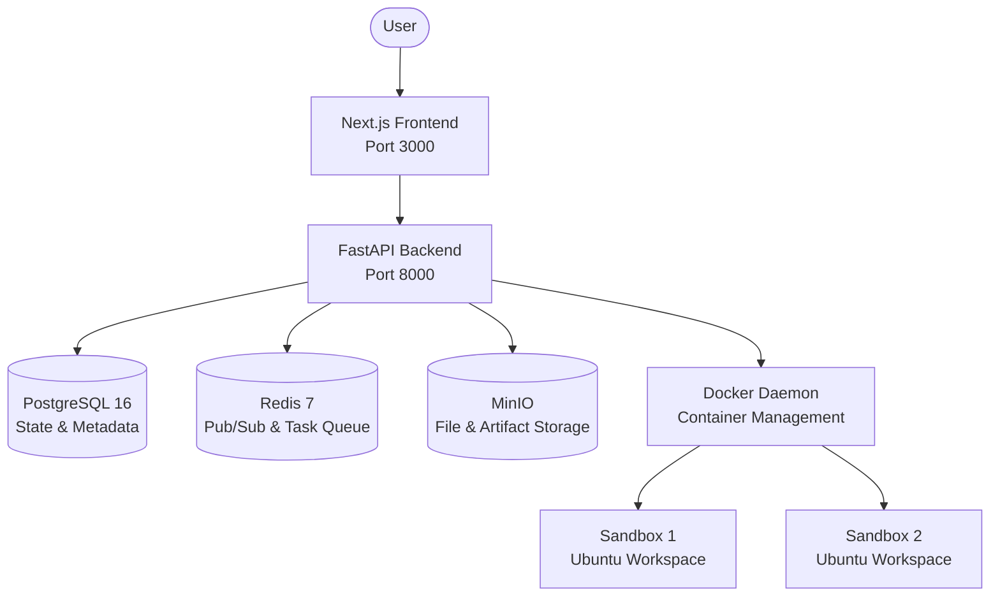

# 🤖 Open GrokBot

> **Your personal team of AI agents that work 24/7 — self-hosted, open-source, and free.**


## What is Open GrokBot?

Open GrokBot is an open-source, self-hosted alternative to x.ai's Grok Bot. It is a platform that gives you an always-on AI agent, ready to perform tasks for you 24/7. It provides a multi-agent environment where agents can collaborate, learn from your demonstrations, and complete end-to-end tasks in isolated sandbox environments.

## Feature Comparison

| Feature | Open GrokBot | Grok Bot (x.ai) |
| :--- | :--- | :--- |
| **Pricing** | Free (Bring your own API key / Local LLM) | Subscription |
| **Hosting** | Self-Hosted / Private Cloud | Cloud (SaaS) |
| **Data Privacy** | 100% Local / Private | Shared with Provider |
| **Custom Agents** | Yes, full autonomy | Limited |
| **Sandbox Execution**| Yes (Docker-in-Docker) | Yes |

## ✨ Key Features

1. 🖥️ **Always-On Cloud PC**: Your agents live in persistent environments, constantly working on tasks in the background.
2. 🌐 **No-API UI Operation**: Agents can interact with graphical user interfaces using Playwright and headless browsers.
3. 🤝 **Autonomous Multi-Agent Group Chats**: Agents can collaborate in groups to solve complex multi-step problems.
4. 🎓 **Demonstration-Based Learning**: Teach your agents how to perform tasks by showing them, and they'll remember for next time.
5. ✅ **End-to-End Task Completion**: From research to execution to reporting, agents handle the full lifecycle.

## 🚀 Quick Start

1. **Clone the repository**
   ```bash
   git clone https://github.com/ishandutta2007/open-grokbot.git
   cd open-grokbot
   ```

2. **Configure environment variables**
   ```bash
   cp .env.example .env
   # Edit .env with your preferred LLM API keys and secrets
   ```

3. **Start the platform**
   ```bash
   make up
   # Or using docker compose directly: docker compose up -d
   ```

4. **Access the UI**
   Open your browser and navigate to `http://localhost:3000`.

## 🏗️ Architecture



## 🛠️ Tech Stack

| Component | Technology |
| :--- | :--- |
| **Frontend** | Next.js, React, Vanilla CSS |
| **Backend** | Python, FastAPI, SQLAlchemy |
| **Database** | PostgreSQL 16 |
| **Cache / Queue** | Redis 7 |
| **Storage** | MinIO (S3 Compatible) |
| **Sandbox** | Docker, Ubuntu 24.04, Playwright |

## ⚙️ Configuration

Configuration is managed via the `.env` file. See `.env.example` for all available options, including database credentials, LLM provider settings (OpenAI, Anthropic, Ollama, etc.), and application secrets.

## 📚 API Documentation

Once the backend is running, you can view the interactive API documentation at `http://localhost:8000/docs` (Swagger UI) or `http://localhost:8000/redoc`.

## 🤝 Contributing

We welcome contributions! Please see our [Contributing Guide](CONTRIBUTING.md) for details on how to set up the development environment, run tests, and submit pull requests.

## 📄 License

This project is licensed under the MIT License - see the [LICENSE](LICENSE) file for details.

---
⭐️ **If you find this project useful, please consider giving it a star!**
