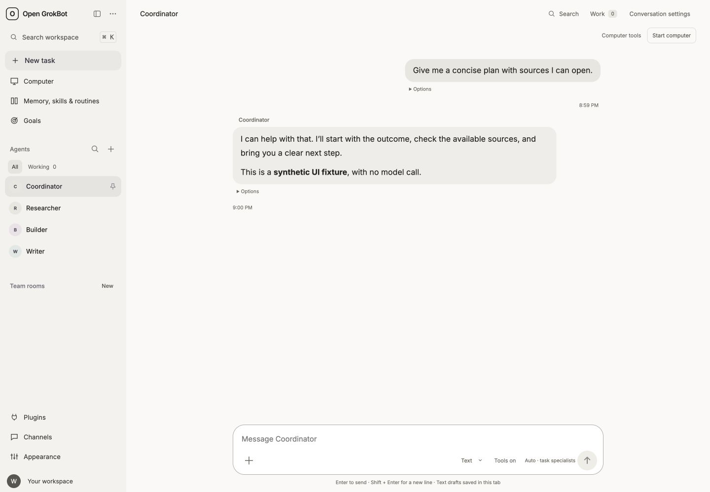
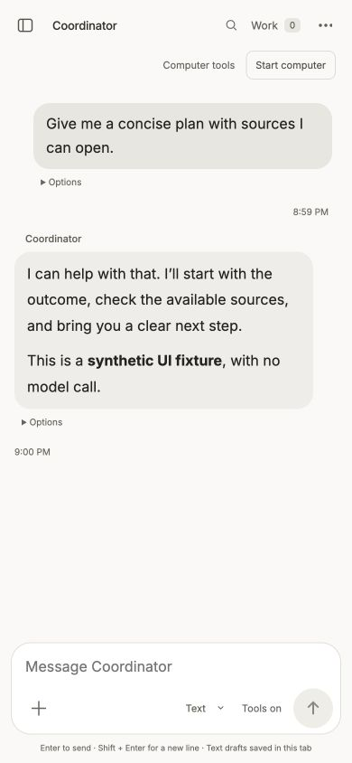

# Grokbot review screenshots

Code under review: [PR #4](https://github.com/HIveAppDeveloper/open-grokbot/pull/4), commit `a848b18870d6d9695c5edcd5eafdf36b376a8a5d`.

These are actual Mac Chrome captures of the built local Next application at desktop 1440×1000 and mobile 390×844. The API and displayed conversation are synthetic fixtures; no model call was made. They demonstrate the reviewed UI and are not screenshots of a production release. No production history, personal account details, credentials or proprietary Grok assets are included.

This evidence-only draft is based on PR #4's branch and adds only this README and two JPEGs. It does not modify PR #4, its source code, or the release approval head.

## Desktop

- Size: 53,075 bytes
- SHA-256: `1e98a02d8aa8459641aec73fbb0579f6731bf4b29e3fc99499f1b0fac16fd078`

## Mobile

- Size: 26,354 bytes
- SHA-256: `673d8dcdb2c347d41626c735e24e05d058332f087c4066d44cdae41b93f1ea8c`

## Existing preview observation

[Exact preview](https://open-grokbot-kjwb0zsfm-hiveapp.vercel.app/) reached READY for the same full code commit. It opened in the existing authorized Mac browser and displayed the redesigned empty workspace. No create/send/login/connector action was performed and protection was not changed.

Final local code verification: 212 backend tests, 40 frontend tests and production build passed. The separate real local creation comparison and synthetic login/browser flows are documented in PR #4. Live model execution, real email/Google login, native device behavior and the original production Create Agent cause remain unverified.

No merge, explicit deployment, production release, paid model call, new credential, sharing activation or Apple submission change is authorized by this evidence.
